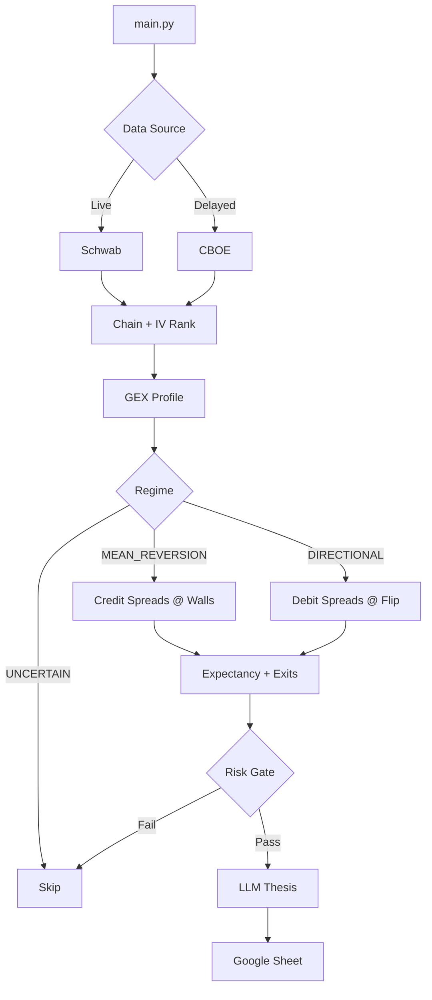

**Current Architectural & Logical View**  
*(based on the latest `Options_AI_Scalping` codebase)*

Your system is now a working end-to-end pipeline that produces defined-risk verticals, scores them, applies a portfolio risk gate, generates a thesis, and writes to Google Sheets. Below is the clean map you need to refine it for **scalping / short-dated profit goals**.

---

### 1. System Architecture (Current)

```
main.py  (async orchestrator + session risk accumulator)
│
├─ Data Layer
│   ├─ schwab_fetcher.py     → live chain (preferred)
│   └─ cboe_fetcher.py       → delayed fallback
│
├─ Utils
│   ├─ greeks.py             → GEX profile (pin, walls, flip)
│   └─ volatility.py         → real IV Rank proxy (yfinance HV rank)
│
├─ Core Logic
│   ├─ regime_classifier.py  → GEX + IV Rank → regime
│   ├─ structure_builder.py  → nearest-strike verticals from GEX levels
│   ├─ expectancy_scorer.py  → PoP × reward − (1−PoP) × risk + exit rules
│   └─ portfolio_risk.py     → daily risk budget gate
│
├─ Synthesis
│   └─ agent_llm.py          → short quantitative thesis
│
└─ Dissemination
    └─ sheet_webhook.py      → flat JSON → Google Sheet
```

**Models**: `market_data` → `regime` → `structures` (Leg + OptionStructure) → `alerts` (ScoredPlay + TradeExits)

---

### 2. Logical Control Flow

```text
For each ticker:
  1. Fetch chain (Schwab live or CBOE delayed)
  2. Compute live IV Rank (yfinance HV proxy)
  3. Build GEX profile (≤45 DTE)
        → net GEX, call_wall, put_wall, gamma_flip
  4. Classify regime
        → MEAN_REVERSION / DIRECTIONAL_BREAKOUT / UNCERTAIN
  5. If tradeable → generate structures
        • MEAN_REVERSION: Bear Call / Bull Put credit spreads near walls
        • DIRECTIONAL_BREAKOUT: Debit spreads around gamma flip
        (nearest liquid strike + dynamic wing)
  6. Score by mathematical expectancy + attach exit rules
  7. Portfolio gate (daily risk budget)
  8. LLM thesis → POST to Google Sheet
```

This is a clean, linear state machine. Good foundation.

---

### 3. What Is Working Well

| Area | Status |
|------|--------|
| GEX topography | Correct formula, pin/walls/flip calculated |
| Nearest-strike + dynamic wing | Much more robust than fixed $5 wings |
| Both sides of breakout | Bullish + bearish debit spreads implemented |
| Real IV Rank proxy | Better than hard-coded mock |
| Explicit exits object | Profit target, stop, time stop, invalidation level |
| Defined-risk only | Credit and debit verticals |
| Live data path | Schwab integration present |
| Sheet output | Working feedback channel |

---

### 4. Gaps That Limit Scalping Profitability

These are the highest-leverage places to improve if the goal is consistent short-dated edge:

**A. Regime logic appears inverted / incomplete**
```python
if net_gex > threshold and iv_rank < threshold → DIRECTIONAL_BREAKOUT
elif net_gex < -threshold or iv_rank high → MEAN_REVERSION
```
Standard interpretation is usually the opposite:
- **Positive GEX** → dealers dampen moves → mean-reversion / pinning
- **Negative GEX** → dealers amplify moves → directional / trend

Also `PINNED_BULLISH` / `PINNED_BEARISH` exist in the structure builder but are never emitted by the classifier. `RegimeState` still has duplicate field definitions and an `is_tradeable` field vs property conflict.

**B. Structure quality filters are still light**
- No minimum credit as % of width
- No delta band filters (e.g. short leg 15–30 delta)
- No explicit expected-move context
- 10 DTE window is wider than classic “scalp”; many true scalps live in 0–3 DTE

**C. Expectancy & sizing**
- Expectancy uses `net_premium` directly; for debit spreads this is negative, which distorts the formula.
- `portfolio_gatekeeper` still references `candidate_play.account_risk_usd`, which no longer exists on `ScoredPlay` (you now use `structure.max_risk`). This is a live bug.
- Position sizing is only a hard risk cap; no volatility or Kelly-style sizing.

**D. No closed-loop feedback**
- Sheet records the idea but there is no systematic way to mark exits and compute realized R-multiple.
- Without outcome data you cannot improve the scorer or regime thresholds.

**E. Operational scalping gaps**
- No intraday re-evaluation / management loop
- No fill/slippage model
- Time stop is set to 0 (intraday) but nothing monitors or acts on it
- Account balance and risk % still hard-coded in several places

---

### 5. Recommended Refinement Map (Profit-Focused)

**Phase 1 – Correctness & Stability (do first)**
1. Fix `RegimeState` (remove duplicates, clean `is_tradeable`).
2. Align regime rules with standard GEX interpretation (or deliberately document why you inverted them).
3. Fix `portfolio_gatekeeper` to use `structure.max_risk`.
4. Make expectancy math sign-aware (credit vs debit).

**Phase 2 – Edge Quality**
1. Add short-leg delta bands and minimum credit/width ratio.
2. Tighten or dual-track DTE (0–3 for true scalps, ≤10 for weekly walls).
3. Bring expected move into scoring (distance of short strike vs 1-day expected move).
4. Prefer structures where GEX level and price structure agree.

**Phase 3 – Profit Capture Loop**
1. Log every alert with a unique ID.
2. Add a simple “mark exit” path (manual or semi-auto) that writes realized P&L and R-multiple back to the Sheet / local DB.
3. Once you have 50–100 closed trades, re-weight the scorer by historical expectancy of similar regime + structure.

**Phase 4 – True Scalping Readiness**
1. Intraday monitor that can update status / suggest exits.
2. Stricter liquidity and fill assumptions.
3. Portfolio heat by net delta / gamma as well as dollar risk.

---

### 6. One-Page Logical Diagram (Mermaid)



---

### Bottom Line

You now have a coherent, working architecture that correctly moves from GEX topography → regime → defined-risk verticals → scored alert → Sheet. That is a strong base.

The biggest levers for **scalping profit** are no longer “more features.” They are:

1. Correct regime interpretation and clean models  
2. Tighter structure selection filters  
3. Sign-correct expectancy + reliable risk tracking  
4. A closed feedback loop on real outcomes  

